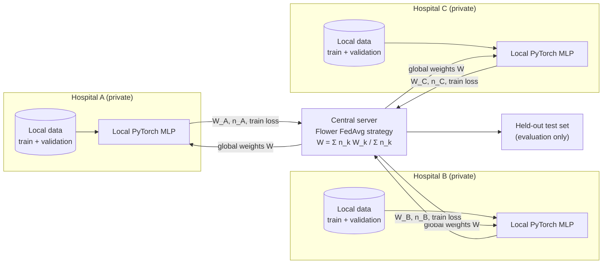
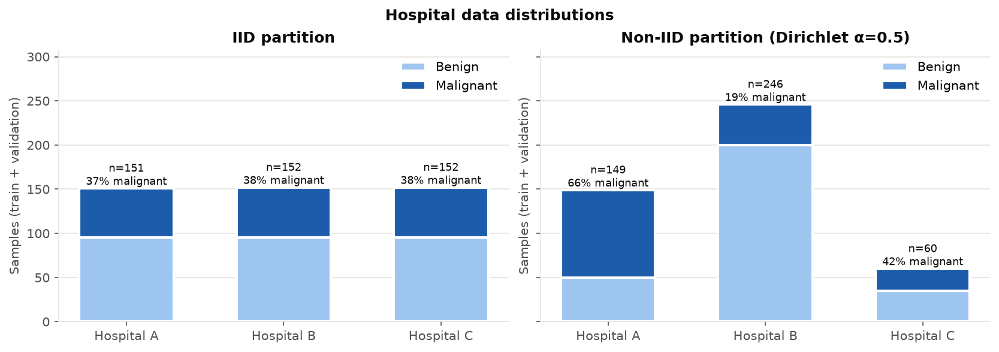
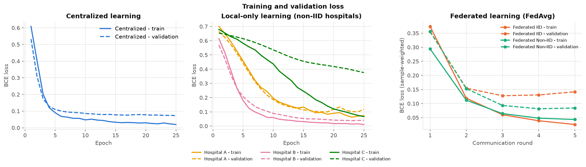
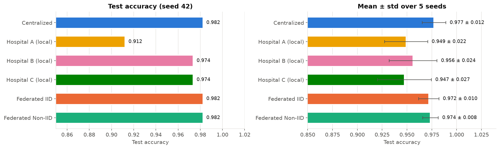
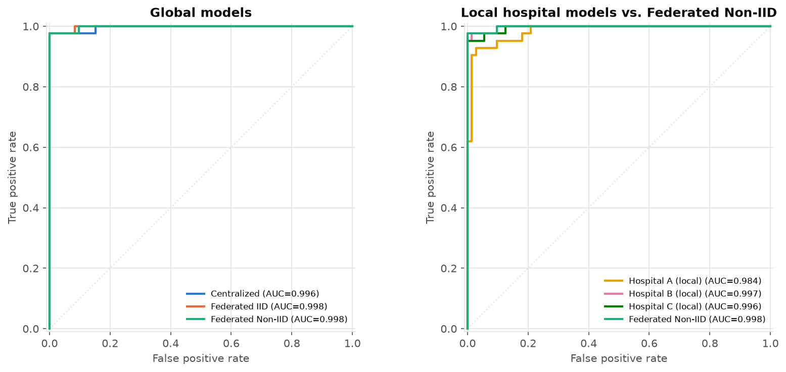
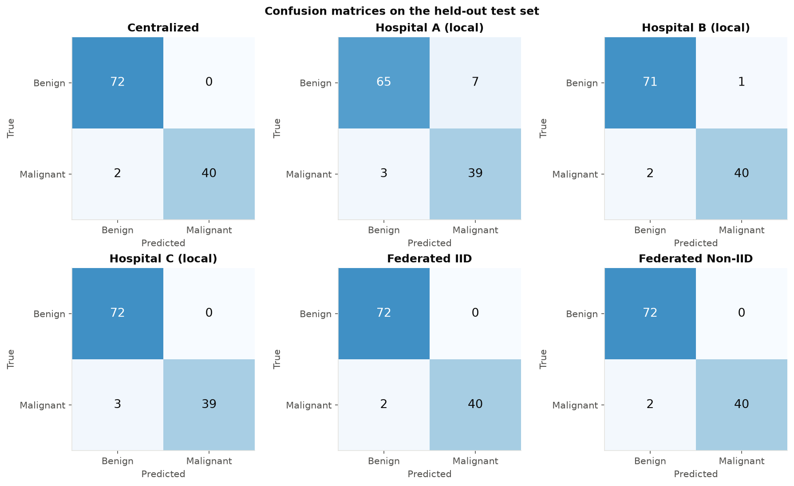
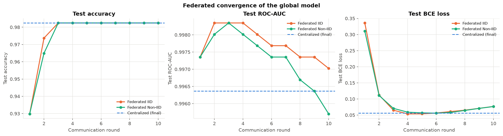
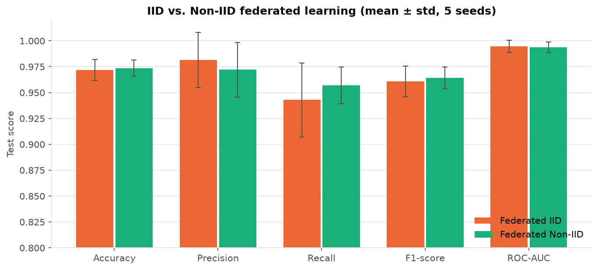
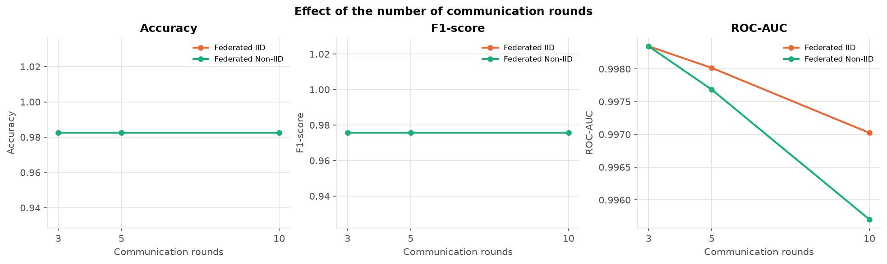
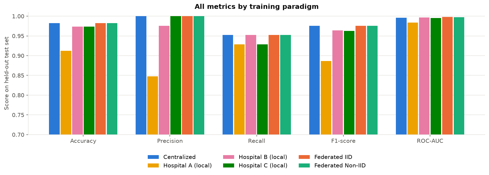

# Federated Learning for Privacy-Preserving Medical AI (PyTorch + Flower)

A complete, reproducible, a research project that simulates three hospitals collaboratively training
a breast-cancer diagnosis model with **Federated Averaging (FedAvg)**, without exchanging patient records.
It compares federated learning with centralized training and with hospitals training alone, under IID and
non-IID data, and includes a privacy and communication analysis and a Streamlit dashboard.

> All numbers in this README come from `python -m experiments.run_all` (seed 42, Python 3.13.9,
> torch 2.15.0+cpu, flwr 1.44.0, Ubuntu 22.04, no GPU). Total runtime is about 55 s on a laptop CPU.

---

## 1. Introduction

Hospitals hold valuable labelled data, but privacy regulation and institutional policy make pooling patient
records difficult. **Federated learning (FL)** trains a shared model by moving the *model* to the data
instead of moving the data to the model. This project implements a full FL pipeline for a tabular medical
classification task and measures what it costs and what it gains compared with the alternatives.

## 2. Research motivation

- Individual hospitals often have **too few cases** to train reliable models, and their case mix is
  **skewed** (a referral oncology centre sees mostly malignant tumours, a screening clinic mostly benign ones).
- Centralizing data maximizes accuracy but concentrates sensitive data in one place.
- FL promises most of the accuracy of centralization while keeping records on-site. How close it gets, how
  data heterogeneity affects it, and what privacy it actually provides are empirical questions.

## 3. Problem statement

Given *K* = 3 hospitals, each with a private, possibly non-IID subset of the Breast Cancer Wisconsin
(Diagnostic) data, train a binary classifier (malignant vs. benign) such that:

1. no hospital transmits raw records;
2. the global model is evaluated on an independent test set that no hospital ever trained on;
3. performance is compared with (A) centralized training and (B) local-only training.

## 4. Federated learning in brief

Each communication round:

1. the **server** sends the current global weights *W* to the hospitals;
2. each **hospital** trains locally for *E* epochs on its own data, producing *W_k*;
3. each hospital returns *W_k* and its number of training samples *n_k*;
4. the server **aggregates** them with sample-weighted FedAvg and updates *W*.

Only model parameters and a few scalars cross the network. Patient records stay at the hospital.

## 5. Architecture



### Code layout

```
federated-medical-ai/
├── config.yaml                 # all hyper-parameters (seed 42)
├── requirements.txt            # dependency ranges (CPU-only torch index)
├── requirements-lock.txt       # exact versions of the verified run
├── data/README.md              # dataset description (loaded from scikit-learn, no files)
├── src/
│   ├── data/                   # dataset.py, preprocessing.py, partition.py, pipeline.py
│   ├── models/                 # neural_network.py (MLP), training.py (shared CPU training loop)
│   ├── federated/              # client.py, server.py, aggregation.py, simulation.py
│   ├── centralized/train.py    # Experiment A (centralized) and B (local-only)
│   ├── evaluation/             # metrics.py, visualization.py
│   ├── privacy/communication.py# communication tracking + payload audit
│   └── utils/                  # config.py, reproducibility.py
├── experiments/                # run_all.py, compare_results.py
├── dashboard/app.py            # Streamlit dashboard (5 pages)
├── results/                    # figures/, metrics/, logs/  (generated)
└── tests/                      # 33 unit / integration tests
```

### How Flower is used (and what is not)

Flower 1.44 is used for the real FL components:

- `flwr.client.NumPyClient` → `HospitalClient` (`src/federated/client.py`), wrapped with `.to_client()`;
- `flwr.server.strategy.FedAvg` → `configure_fit`, `aggregate_fit`, `configure_evaluate`,
  `aggregate_evaluate` and server-side `evaluate` (`src/federated/server.py`);
- `flwr.server.client_manager.SimpleClientManager` for client registration and sampling;
- `flwr.common.Parameters`: every message is serialized exactly as Flower serializes it, and
  communication volume is measured on those bytes.

**Honest note:** Flower's `start_simulation` needs **Ray** (heavy, not needed for 3 clients on a laptop),
and the newer `flwr run` / `run_simulation` API needs a packaged ServerApp/ClientApp project. To stay
lightweight, the server loop calls Flower's strategy and clients **in-process** through a small
`InProcessClientProxy`. Only the network transport is replaced by function calls. As a cross-check,
a native NumPy implementation of FedAvg (`src/federated/aggregation.py`) is selectable with
`federated.aggregation_backend: native`. It produced the same final metrics as Flower's strategy, with a
maximum difference of **3.4 × 10⁻⁹** (`results/metrics/aggregation_backend_check.json`). A unit test checks
that the two are numerically equal.

## 6. Dataset

**Breast Cancer Wisconsin (Diagnostic)**, `sklearn.datasets.load_breast_cancer`: 569 samples,
30 numeric features, 212 malignant / 357 benign. We encode **malignant = 1** (the clinically critical
positive class). See [`data/README.md`](data/README.md).

**Split protocol (no leakage):**

1. A stratified **20 % held-out test set** (114 samples) is reserved first. It depends only on the seed, so
   every experiment uses exactly the same test samples.
2. The other 455 samples are partitioned across the 3 hospitals. Every sample belongs to exactly one hospital
   (checked at runtime and in the tests).
3. Each hospital keeps 20 % of its share as a **local validation set**.
4. **Standardization uses training data only.** In FL, each hospital sends only its count, per-feature sums
   and sums of squares, and the server builds the global mean/std. This is mathematically identical to
   fitting on the union of training sets (tested). Local-only models use their own local statistics.

**Partitions (seed 42):**

| Hospital | IID: samples (malignant %) | Non-IID (Dirichlet α = 0.5): samples (malignant %) |
|---|---|---|
| Hospital A | 151 (37 %) | 149 (66 %), resembling an oncology referral centre |
| Hospital B | 152 (38 %) | 246 (19 %), resembling a screening clinic |
| Hospital C | 152 (38 %) | 60 (42 %), a small hospital |

Non-IID uses per-class Dirichlet proportions, which gives both **label skew and quantity skew**, with a
guarantee of at least 5 samples per class per hospital.



## 7. Model

```
Input (30) → Linear(30, 64) → ReLU → Dropout(0.2) → Linear(64, 32) → ReLU → Linear(32, 1) → Sigmoid
```

4,097 trainable parameters (about 16 KB). Training uses binary cross-entropy (`BCEWithLogitsLoss`, which is
BCE on the sigmoid output computed in a numerically stable way), Adam (lr = 1e-3), batch size 16, and CPU only
with one torch thread (the fastest setting for this tiny model). There is no early stopping and the test set
is never used during training.

## 8. FedAvg formulation

$$
W_{\text{global}}^{(t+1)} \;=\; \frac{\sum_{k=1}^{K} n_k \, W_k^{(t+1)}}{\sum_{k=1}^{K} n_k}
$$

or, in plain text, `W_global = sum(n_k * W_k) / sum(n_k)`, where

- `W_k` is the parameter vector returned by client *k* after local training from `W_global^(t)`;
- `n_k` is the number of local **training** samples at client *k*.

## 9. Experimental methodology

| Exp. | Description | Training budget |
|---|---|---|
| A | **Centralized**: one model on the pooled training data (455 × 80 % = 364 train / 91 val) | 25 epochs |
| B | **Local-only**: each hospital alone on its non-IID data, no communication | 25 epochs each |
| C | **Federated, IID** partition | 5 rounds × 5 local epochs |
| D | **Federated, non-IID** partition | 5 rounds × 5 local epochs |
| E | **Federated with 3 / 5 / 10 rounds**, IID and non-IID | 5 local epochs per round |
| + | **Robustness**: A, B, C, D repeated over seeds 42–46 (new split, partition and initialization each time) | as above |

All methods start from the same seed-determined initial weights and are evaluated on the same held-out test
set with a 0.5 threshold. Metrics: accuracy, precision, recall, F1, ROC-AUC, confusion matrix, test log-loss,
plus training and validation loss curves. In FL the validation loss is the sample-weighted loss of the
**global** model on each hospital's private validation set.

## 10. Results

### Main comparison (seed 42, held-out test set, n = 114)

| Model | Accuracy | Precision | Recall | F1 | ROC-AUC | Test loss | TN | FP | FN | TP |
|:--|--:|--:|--:|--:|--:|--:|--:|--:|--:|--:|
| Centralized        | 0.9825 | 1.0000 | 0.9524 | 0.9756 | 0.9964 | 0.0561 | 72 | 0 | 2 | 40 |
| Hospital A (local) | 0.9123 | 0.8478 | 0.9286 | 0.8864 | 0.9838 | 0.1724 | 65 | 7 | 3 | 39 |
| Hospital B (local) | 0.9737 | 0.9756 | 0.9524 | 0.9639 | 0.9967 | 0.0737 | 71 | 1 | 2 | 40 |
| Hospital C (local) | 0.9737 | 1.0000 | 0.9286 | 0.9630 | 0.9957 | 0.1126 | 72 | 0 | 3 | 39 |
| Federated IID      | 0.9825 | 1.0000 | 0.9524 | 0.9756 | 0.9980 | 0.0538 | 72 | 0 | 2 | 40 |
| Federated Non-IID  | 0.9825 | 1.0000 | 0.9524 | 0.9756 | 0.9977 | 0.0569 | 72 | 0 | 2 | 40 |

### Robustness: mean ± std over 5 seeds (42–46)

| Model | Accuracy | Precision | Recall | F1 | ROC-AUC |
|:--|:--|:--|:--|:--|:--|
| Centralized        | 0.9772 ± 0.0119 | 0.9768 ± 0.0244 | 0.9619 ± 0.0323 | 0.9687 ± 0.0168 | 0.9946 ± 0.0054 |
| Hospital A (local) | 0.9491 ± 0.0218 | 0.9244 ± 0.0487 | 0.9429 ± 0.0490 | 0.9318 ± 0.0287 | 0.9857 ± 0.0077 |
| Hospital B (local) | 0.9561 ± 0.0242 | 0.9608 ± 0.0178 | 0.9190 ± 0.0683 | 0.9379 ± 0.0374 | 0.9851 ± 0.0135 |
| Hospital C (local) | 0.9474 ± 0.0272 | 0.9547 ± 0.0398 | 0.9048 ± 0.0976 | 0.9242 ± 0.0462 | 0.9870 ± 0.0087 |
| Federated IID      | 0.9719 ± 0.0102 | 0.9816 ± 0.0265 | 0.9429 ± 0.0356 | 0.9610 ± 0.0148 | 0.9948 ± 0.0059 |
| Federated Non-IID  | 0.9737 ± 0.0078 | 0.9721 ± 0.0266 | 0.9571 ± 0.0178 | 0.9641 ± 0.0104 | 0.9938 ± 0.0052 |

(Hospitals are re-partitioned for every seed, so "Hospital A" is a different hospital in each seed. The
local-only rows summarize *a typical single hospital*.)

### Experiment E: communication rounds (seed 42)

| Setting | Rounds | Accuracy | F1 | ROC-AUC | Test loss | Traffic (KB) |
|:--|--:|--:|--:|--:|--:|--:|
| Federated IID     | 3  | 0.9825 | 0.9756 | 0.9983 | 0.0651 | 452.4 |
| Federated IID     | 5  | 0.9825 | 0.9756 | 0.9980 | 0.0538 | 753.9 |
| Federated IID     | 10 | 0.9825 | 0.9756 | 0.9970 | 0.0768 | 1507.9 |
| Federated Non-IID | 3  | 0.9825 | 0.9756 | 0.9983 | 0.0708 | 452.4 |
| Federated Non-IID | 5  | 0.9825 | 0.9756 | 0.9977 | 0.0569 | 753.9 |
| Federated Non-IID | 10 | 0.9825 | 0.9756 | 0.9957 | 0.0764 | 1507.9 |

### Figures (`results/figures/`)

| | |
|---|---|
|  |  |
|  |  |
|  |  |
|  |  |

Raw outputs: `results/metrics/*.json|csv|md` and `results/logs/` (run log and per-message communication logs).

## 11. Performance analysis

- **FL matches centralized training on this task.** With seed 42, both federated models have exactly the
  centralized confusion matrix (2 false negatives, 0 false positives). Over 5 seeds the mean accuracy is
  0.977 (centralized), 0.974 (FL non-IID) and 0.972 (FL IID). These differences are well within one standard
  deviation, and one test sample is worth 0.88 accuracy points. **There is no evidence of a gap. That does
  not prove there is none.**
- **FL beats a typical hospital training alone.** Local-only models average 0.947–0.956 accuracy with about
  twice the variance (std 0.022–0.027 vs. 0.008–0.010) and noticeably lower recall (0.90–0.94 vs. 0.94–0.96).
  Recall is the clinically critical metric, because a false negative is a missed cancer. The benefit is
  largest for small or skewed hospitals. With seed 42, Hospital A (66 % malignant) learns a malignant-leaning
  prior and produces 7 false positives on the balanced test set.
- **The non-IID penalty is not measurable here.** Dirichlet α = 0.5 gives strong label and quantity skew,
  yet FL non-IID ≈ FL IID. The dataset is small, low-dimensional and nearly linearly separable, so client
  drift has little room to hurt. Expect a larger gap on harder, higher-dimensional data, with smaller α, or
  with more local epochs.
- **More rounds is not better here.** Accuracy saturates by round 3. Test log-loss is lowest at rounds 4–5
  and rises at 10 rounds while training loss keeps falling, which is mild overfitting (the IID validation
  loss also rises after round 3). Ten rounds doubles communication for no gain, so 3–5 rounds is the sweet
  spot for this configuration.
- **Caveat:** 114 test samples and 5 seeds give coarse estimates. Differences in the third decimal should not
  be over-interpreted.

## 12. Privacy discussion

**What is transmitted (measured, 5 rounds, 3 hospitals):**

| Quantity | Value |
|---|---|
| Clients / rounds | 3 / 5 |
| Parameters per model | 4,097 |
| Messages | 45 (per round: 3 fit instructions, 3 fit results, 3 evaluate instructions) |
| Parameters transmitted | 184,365 |
| Bytes server → clients | 514,680 |
| Bytes clients → server | 257,340 |
| **Total traffic** | **753.9 KB** |
| Fields sent by hospitals | `parameters`, `num_examples`, `train_loss`, `client` (name) |
| Raw patient bytes kept local | 58,240 (about 57 KB) |
| **Raw patient bytes transmitted** | **0** |
| Payload audits passed | 30 / 30 |

**Demonstration that raw data is not transmitted.** Every client → server message is intercepted by the
`CommunicationTracker` and checked by `audit_payload` (`src/privacy/communication.py`) against the hospital's
raw and standardized records. The audit checks that no tensor has the shape of the data matrix, that no
30-value patient row appears as a contiguous sequence in the payload, and that the label vector does not
appear. A unit test confirms that the audit does flag a payload containing raw rows. Payload size is constant
(4,097 values) regardless of how many patients a hospital has. The full per-message log is in
`results/logs/communication_log_*.json`.

Note that on this tiny dataset **FL moves about 13× more bytes than the raw data itself**. FL's value here is
data locality, not bandwidth.

### Limitations of the privacy claim: FL ≠ guaranteed privacy

Plain FedAvg **does not** guarantee privacy:

- **Model updates leak information.** Gradient and weight inversion attacks can reconstruct training records,
  especially with small datasets and small batches like here. Membership-inference attacks can reveal whether a
  patient was in a hospital's data.
- **The server sees every individual update.** **Secure aggregation** (cryptographic masking so that only
  the sum is revealed) is needed to hide them.
- **Metadata leaks:** `n_k`, local losses and the federated standardization statistics reveal properties
  of each hospital's population, for example its malignancy rate.
- **Differential privacy** (DP-SGD or DP-FedAvg with update clipping and calibrated noise) is required for a
  formal (ε, δ) bound on what any one patient can influence.
- Real deployments also need encrypted, authenticated transport, access control, and defences against
  malicious clients (model poisoning, Byzantine updates).

The audit above is a **sanity demonstration** that records are not copied into messages. It is not a
privacy proof.

## 13. Limitations

- Small, clean, nearly separable dataset: absolute scores are high for every method, and differences are small
  relative to test-set noise.
- The hospitals are **simulated** partitions of a single dataset. Real multi-site data also differs in feature
  distributions (scanners, protocols, demographics), which this project does not model.
- In-process simulation: there is no network latency, stragglers, dropouts or failures.
- Fixed decision threshold (0.5) and fixed epochs. There is no hyper-parameter search, which was deliberate so
  that the held-out test set is never used for model selection.
- No secure aggregation and no differential privacy (see Section 12).
- Requires **Python ≥ 3.11** because `flwr` 1.44 does not support 3.10.

## 14. Installation (Ubuntu 22.04, CPU only)

Python ≥ 3.11 is required. Ubuntu 22.04 ships Python 3.10, so use one of these:

```bash
# Option 1 (deadsnakes PPA)
sudo add-apt-repository ppa:deadsnakes/ppa && sudo apt update
sudo apt install python3.11 python3.11-venv
python3.11 -m venv .venv
```

```bash
# Option 2: an existing conda / pyenv Python >= 3.11 (the verified run used Miniconda Python 3.13.9)
python -m venv .venv
```

Then:

```bash
cd federated-medical-ai
python -m venv .venv
source .venv/bin/activate
pip install --upgrade pip
pip install -r requirements.txt          # CPU-only torch from download.pytorch.org/whl/cpu
# for the exact verified versions instead:  pip install -r requirements-lock.txt
```

No CUDA, GPU, paid API or large pretrained model is needed. The virtual environment takes about 1.9 GB on
disk (mostly CPU torch, streamlit and their dependencies). Measured peak RAM of `python -m experiments.run_all` is
about **560 MB** (mostly the Python, torch, Flower and matplotlib runtimes). The model has 4k parameters and
the data is under 100 KB.

## 15. Execution

```bash
source .venv/bin/activate
python -m pytest -q                      # 33 tests
python -m experiments.run_all            # all experiments + tables + figures (~1 min)
python -m experiments.compare_results    # rebuild tables/figures from saved metrics only
streamlit run dashboard/app.py           # dashboard at http://localhost:8501
```

Useful options:

- `python -m experiments.run_all --skip-robustness` skips the 5-seed repetition (about 20 s).
- Edit `config.yaml` to change the number of hospitals (`partition.num_clients` and `client_names`),
  rounds, local epochs, Dirichlet α, learning rate, or the aggregation backend.

### Dashboard pages

1. **Project overview**: description, FL architecture diagram, dataset facts, IID and non-IID partitions.
2. **Training**: choose IID or non-IID, rounds, local epochs and seed, then start a live Flower simulation
   with a progress bar, per-round table, curves and confusion matrix.
3. **Results**: metric tiles, comparison and robustness tables, training curves, ROC curves, confusion
   matrices, and the rounds experiment.
4. **Hospital comparison**: local models vs. the global federated model, plus the per-hospital validation
   loss of the global model over rounds.
5. **Privacy analysis**: data decentralization, communication statistics, traffic per round, message log,
   payload audit, and privacy limitations.

## 16. Screenshots

The result figures above are generated by the pipeline. To add dashboard screenshots, run
`streamlit run dashboard/app.py`, capture each page, save the images as
`docs/screenshots/<page>.png`, and reference them here:

```markdown


```

#17. Future improvements

- **Differential privacy** (Opacus DP-SGD or Flower's DP wrappers) with a privacy/utility curve over ε.
- **Secure aggregation** (Flower's SecAgg+).
- Heterogeneity-robust algorithms: **FedProx**, SCAFFOLD, FedAdam; personalization (fine-tuning, FedBN).
- Feature-shift non-IID (site-specific measurement bias), partial participation and client dropouts.
- Run a real distributed deployment (`flwr` SuperLink/SuperNodes) over TLS.
- Larger or multimodal medical datasets (e.g. MedMNIST) with cross-validation and statistical tests.
- Calibration analysis and threshold selection on validation data for a target sensitivity.


